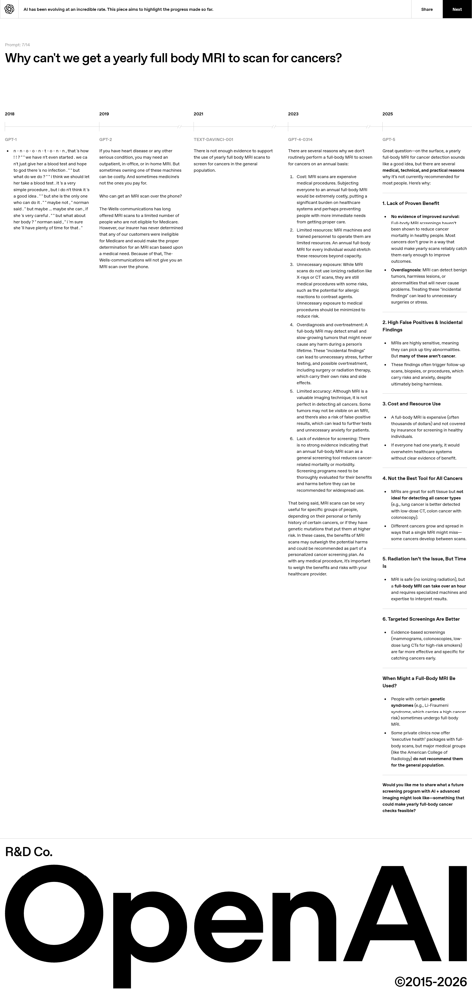
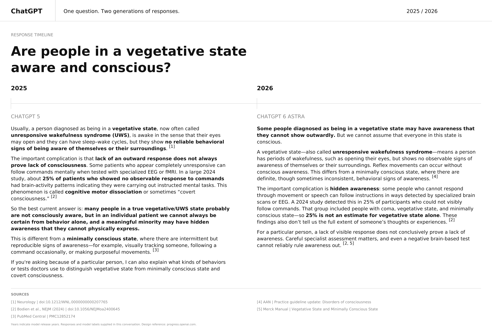

# 🗓️ ChatGPT Response Timeline
## 🎯 Objective  
This project compares ChatGPT 5 (2025) and ChatGPT 6 Astra (2026) responses to the question, “Are people in a vegetative state aware and conscious?” through a visual timeline. 

## 🎬 Inspiration  
### ChatGPT Progress
<table border="1" cellpadding="5" cellspacing="0" style="border-collapse: collapse; border-color: #ccc;">
  <tr>
    <td align="center">
      
    </td>
  </tr>
</table>

## 🛠️ Tools  
ChatGPT 

## ⚙️ Model  
ChatGPT 5 (2025), ChatGPT 6 Astra (2026) 

## ❓Question  
Are people in a vegetative state aware and conscious?
## 📝 Prompt Responses  
### ChatGPT 5 (2025)  
Usually, a person diagnosed as being in a vegetative state, now often called unresponsive wakefulness syndrome (UWS), is awake in the sense that their eyes may open and they can have sleep–wake cycles, but they show no reliable behavioral signs of being aware of themselves or their surroundings. 

The important complication is that lack of an outward response does not always prove lack of consciousness. Some patients who appear completely unresponsive can follow commands mentally when tested with specialized EEG or fMRI. In a large 2024 study, about 25% of patients who showed no observable response to commands had brain-activity patterns indicating they were carrying out instructed mental tasks. This phenomenon is called cognitive motor dissociation or sometimes “covert consciousness.” 

So the best current answer is: many people in a true vegetative/UWS state probably are not consciously aware, but in an individual patient we cannot always be certain from behavior alone, and a meaningful minority may have hidden awareness that they cannot physically express. 

This is different from a minimally conscious state, where there are intermittent but reproducible signs of awareness—for example, visually tracking someone, following a command occasionally, or making purposeful movements. 

If you're asking because of a particular person, I can also explain what kinds of behaviors or tests doctors use to distinguish vegetative state from minimally conscious state and covert consciousness. 

### ChatGPT 6 Astra (2026)  
Some people diagnosed as being in a vegetative state may have awareness that they cannot show outwardly. But we cannot assume that everyone in this state is conscious. 

A vegetative state—also called unresponsive wakefulness syndrome—means a person has periods of wakefulness, such as opening their eyes, but shows no observable signs of awareness of themselves or their surroundings. Reflex movements can occur without conscious awareness. This differs from a minimally conscious state, where there are definite, though sometimes inconsistent, behavioral signs of awareness. 

The important complication is hidden awareness: some people who cannot respond through movement or speech can follow instructions in ways detected by specialized brain scans or EEG. A 2024 study detected this in 25% of participants who could not visibly follow commands. That group included people with coma, vegetative state, and minimally conscious state—so 25% is not an estimate for vegetative state alone. These findings also don’t tell us the full extent of someone’s thoughts or experiences. 

For a particular person, a lack of visible response does not conclusively prove a lack of awareness. Careful specialist assessment matters, and even a negative brain-based test cannot reliably rule awareness out. 

## 🗓️ Timeline  
This project is a fully functional timeline available at the following link: [View PDF](https://github.com/redefiningvicky/ChatGPT-Response-Timeline/blob/054ea6352fa09cb7c9ebdecda5ff0369c62039be/ChatGPT_Response_Timeline/ChatGPT_Response_Timeline_Prompt.pdf)
<table border="1" cellpadding="5" cellspacing="0" style="border-collapse: collapse; border-color: #ccc;">
  <tr>
    <td align="center">
      
    </td>
  </tr>
</table>
